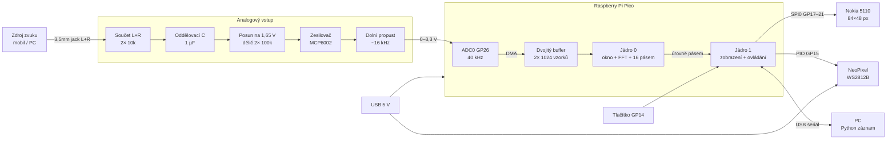

# Audio spectrum analyzer

DE2 team project – Raspberry Pi Pico W, MicroPython.

## Goal
Sample audio from a microphone, split it into frequency bands
and show a live spectrum on a display and a NeoPixel strip.

## Hardware
- Raspberry Pi Pico W

- Microphone module 
- display
- NeoPixel strip (LED strip)

## Block diagram

## Team
| Name | Part |
| --- | --- |
| Rauf Iusupov | ... |
| Marek Malina | ... |
| Jaroslav Kapaňa | ... |

## Planned files
- `main.py` – main loop
- `config.py` – pins and settings
- `mic.py` – ADC sampling
- `spectrum.py` – FFT and frequency bands
- `display.py` – bars on the display
- `leds.py` – NeoPixel output
