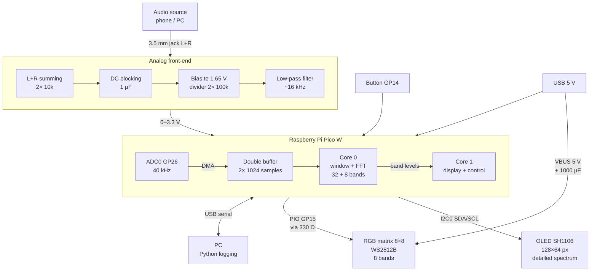

# Audio spectrum analyzer

DE2 team project – Raspberry Pi Pico W, MicroPython.

## Goal

A pocket-size, real-time audio analyzer built on a Raspberry Pi Pico W.
Plug in a phone or PC through a 3.5 mm jack and the device instantly shows
what the sound is made of: which frequencies it contains, how loud it is,
and which musical note is playing.

### Why it is useful
- **Musicians** can tune an instrument with the built-in tuner (±5 cents)
  without a phone app or a separate tuner.
- **Recording and streaming:** the loudness mode shows RMS and peak level
  in dBFS and warns before the signal clips, so distortion is caught early.
- **Music visualization:** the RGB matrix turns any music into a live,
  colourful spectrum.
- **Education:** it makes signal processing visible – sampling, frequency
  bands, decibels and FFT are shown live instead of only in formulas.

### What the project demonstrates
- **Analog design:** summing L+R channels, DC bias to 1.65 V and an
  anti-aliasing low-pass filter, so a line-level signal can be safely
  measured by the 3.3 V ADC.
- **Fast sampling:** ADC at 40 kHz with DMA into a double buffer.
- **Digital signal processing on a microcontroller:** windowing, FFT,
  band levels in dB, RMS/peak measurement and pitch detection.
- **Dual-core design:** core 0 processes the audio, core 1 drives the
  displays and the button, so the picture stays smooth.
- **Two outputs:** a detailed view on the OLED (I2C) and a colourful
  overview on the 8×8 RGB LED matrix (WS2812B).
- **Simple control:** three modes switched with a single button.

## Modes

**Mode 1 – Spectrum.** Shows the distribution of sound in 8 frequency bands
(63, 125, 250, 500 Hz, 1, 2, 4, 8 kHz).
- Display: level of each band in dB and its frequency
- Matrix: 8 colour columns (green → yellow → red) with peak hold

**Mode 2 – Loudness.** Measures the signal level in dBFS.
- Display: RMS, sample peak, CLIP warning
- Matrix: full-width VU meter, the top row blinks red on clipping

**Mode 3 – Tuner.** Detects the dominant frequency.
- Display: note (e.g. A), frequency in Hz, deviation in cents,
  arrow left or right towards the nearest note
- Matrix: green = in tune (±5 cents), red = out of tune

**Controls:** short button press = next mode, long press = reset maximum and peak hold.

## Hardware
- Raspberry Pi Pico W


- 3.5 mm jack input (terminal block adapter)


- RGB LED matrix 8×8 NeoPixel WS2812B


- OLED display SH1106 128×64, I2C


### Bill of materials

| Part | Qty | Datasheet / docs | Status |
| --- | --- | --- | --- |
| Raspberry Pi Pico W (RP2040) | 1 | [Pico W](https://datasheets.raspberrypi.com/picow/pico-w-datasheet.pdf), [RP2040](https://datasheets.raspberrypi.com/rp2040/rp2040-datasheet.pdf) | have |
| DFRobot Gravity Expansion Board for Pico (DFR0848) | 1 | [wiki](https://wiki.dfrobot.com/DFR0848) | have |
| OLED display SH1106 128×64, I2C | 1 | [SH1106](https://www.crystalfontz.com/controllers/SinoWealth/SH1106) | have |
| Breadboard, jumper wires, USB cable | – | – | have |
| AUX cable 3.5 mm jack–jack | 1 | – | have |
| RGB LED matrix 8×8 WS2812B | 1 | [WS2812B](https://cdn-shop.adafruit.com/datasheets/WS2812B.pdf) | to get |
| 3.5 mm jack to terminal block adapter | 1 | – | to get |
| Push button | 1 | – | to get |
| Resistor 10 kΩ | 2 | – | to get |
| Resistor 100 kΩ | 2 | – | to get |
| Resistor 1 kΩ | 1 | – | to get |
| Resistor 330 Ω | 1 | – | to get |
| Capacitor 1 µF | 1 | – | to get |
| Capacitor 10 nF | 1 | – | to get |
| Capacitor 1000 µF / 10 V | 1 | – | to get |
| Level shifter 74AHCT125 (optional) | 1 | [SN74AHCT125](https://www.ti.com/lit/ds/symlink/sn74ahct125.pdf) | only if the matrix does not respond reliably |

## Block diagram



## Wiring diagram

TBD – full schematic of the analog front-end, OLED, RGB matrix and button (`docs/wiring.png`).

## Pinout

Board: Raspberry Pi Pico W on DFRobot Pico Gravity Board.

| Device | Device pin | Pico W GPIO | Physical pin | Gravity Board header |
| --- | --- | --- | --- | --- |
| OLED SH1106 | VCC | 3V3(OUT) | 36 | I2C0 – 3V3 |
| OLED SH1106 | GND | GND | 38 | I2C0 – GND |
| OLED SH1106 | SDA | GP4 (I2C0 SDA) | 6 | I2C0 – D/4 |
| OLED SH1106 | SCK | GP5 (I2C0 SCL) | 7 | I2C0 – C/5 |
| RGB matrix WS2812B | DIN | GP15, via 330 Ω | 20 | Digital – GP15 |
| RGB matrix WS2812B | 5V | VBUS (5 V), 1000 µF to GND | 40 | VBUS (center header) |
| RGB matrix WS2812B | GND | GND | 38 | Digital – GND |
| Analog front-end | output | GP26 (ADC0) | 31 | Analog – A/26 |
| Analog front-end | supply | 3V3(OUT) | 36 | Analog – 3V3 |
| Button | signal | GP14 | 19 | Digital – GP14 |

## Timing of tasks

Planned values, to be verified by measurement.

| Task | Runs on | Rate / period | Note |
| --- | --- | --- | --- |
| ADC sampling | DMA | 40 kHz | no CPU load |
| New block ready | DMA → core 0 | every 25.6 ms | 1024 samples / 40 kHz |
| Window + FFT + bands | core 0 | once per block | must finish in < 25.6 ms, otherwise smaller block or `ulab` |
| Loudness / tuner calculation | core 0 | once per block | depends on the active mode |
| OLED refresh | core 1 | target ~20 fps (50 ms) | full frame over I2C at 400 kHz takes ≈ 25 ms |
| RGB matrix refresh | core 1 | target ~30 fps | data for 64 LEDs ≈ 2 ms |
| Button check | core 1 | every 10 ms | 50 ms debounce, long press ≥ 1 s |
| USB serial logging | core 1 | optional, ~10 Hz | for recording on PC |

## Project schedule

| Week | Focus | Rauf Iusupov | Marek Malina | Jaroslav Kapaňa |
| --- | --- | --- | --- | --- |
| 1 | Proposal and architecture | components, BOM | block diagram | repository, README |
| 2 | Device modules | analog front-end, ADC test, wiring diagram | FFT speed test, band calculation | OLED, RGB matrix and button tests |
| 3 | Integration | Mode 2 Loudness, matrix power | Mode 1 Spectrum | Mode 3 Tuner, `main.py`, dual-core |
| 4 | Verification and polish | measurements with real audio | performance tuning | edge cases, documentation |
| 5 | Demonstration | poster, video, demo | poster, video, demo | poster, video, demo |

## Software and libraries

| Item | Version / source | Used for |
| --- | --- | --- |
| MicroPython firmware | v1.29.0 (2026-08-24), RPI_PICO_W, micropython.org | runtime |
| `machine` (Pin, I2C, ADC) | built-in | hardware access |
| `neopixel` | built-in | RGB LED matrix |
| `math`, `time`, `random` | built-in | calculations, timing, test data |
| `sh1106.py` | driver supplied in DE2 Lab 6 | OLED display |
| `ulab` | planned, only if pure-Python FFT is too slow | FFT |
| Thonny | TBD | IDE |

## Repository structure

```
de2-audio-spectrum/
├── README.md
├── main.py               main loop, mode switching (TBD)
├── config.py             pins and settings (TBD)
├── audio_input.py        ADC sampling (TBD)
├── spectrum.py           FFT and frequency bands – Mode 1 (TBD)
├── loudness.py           RMS, peak, clipping – Mode 2 (TBD)
├── tuner.py              dominant frequency, note, cents – Mode 3 (TBD)
├── display.py            OLED output (TBD)
├── matrix.py             RGB LED matrix output (TBD)
├── lib/
│   └── sh1106.py         OLED driver
├── tests/
│   ├── test_oled.py      OLED – Mode 1 layout
│   ├── test_mode2.py     OLED – Mode 2 layout
│   ├── test_matrix.py    RGB matrix (TBD)
│   ├── test_adc.py       audio input (TBD)
│   └── test_button.py    button (TBD)
└── docs/
    ├── block_diagram.png
    └── wiring.png        (TBD)
```

## Classes / API (draft)

### `AudioInput` – audio_input.py
- `AudioInput(pin=26, n=256)` – ADC input on GP26
- `read_block()` → list of n samples (0–65535)

### `Spectrum` – spectrum.py
- `bands(samples)` → 8 levels in dB (63 Hz, 125 Hz … 8 kHz)

### `Loudness` – loudness.py
- `measure(samples)` → (rms_dbfs, peak_dbfs, clip)

### `Tuner` – tuner.py
- `detect(samples)` → (note, freq_hz, cents)

### `OledView` – display.py
- `show_spectrum(levels)` – Mode 1
- `show_loudness(rms, peak, clip)` – Mode 2
- `show_tuner(note, freq_hz, cents)` – Mode 3

### `Matrix` – matrix.py
- `bars(heights, peaks)` – 8 columns, height 0–8, green → yellow → red, peak hold dots
- `vu(level, clip)` – full-width VU meter, top row blinks red on clip
- `tuned(ok)` – whole matrix green (in tune) or red (out of tune)
- `clear()`

### Button – GP14
- short press = next mode (Spectrum → Loudness → Tuner)
- long press = reset maximum and peak hold

## Component tests

| Component | Interface / pins | Test file | Status |
| --- | --- | --- | --- |
| OLED SH1106 128×64 – Mode 1 layout (spectrum) | I2C0, GP4/GP5 | `tests/test_oled.py` | works |
| OLED SH1106 128×64 – Mode 2 layout (loudness) | I2C0, GP4/GP5 | `tests/test_mode2.py` | works |
| RGB LED matrix 8×8 WS2812B | GP15 | `tests/test_matrix.py` | not tested yet |
| Audio input (jack + analog front-end) | ADC0, GP26 | `tests/test_adc.py` | not tested yet |
| Button (mode select) | GPIO, GP14 | `tests/test_button.py` | not tested yet |

Tests for Modes 1 and 2 use generated test data, not real audio yet.

## Team

| Name | Part |
| --- | --- |
| Rauf Iusupov | Hardware + Mode 2 Loudness (RMS, peak, clipping, VU meter) |
| Marek Malina | Mode 1 Spectrum (FFT, 8 bands, peak hold) |
| Jaroslav Kapaňa | Mode 3 Tuner + main.py, button, mode switching |
| All | README, poster, video, testing |

## Open questions
- Is an amplifier needed? Not for now, decide after testing the audio input.
- Is the 74AHCT125 level shifter needed? Only if the matrix does not respond reliably with 3.3 V data.
- OLED in Mode 1: 8 bands (as in the mode description) or detailed 32-band spectrum (as in the block diagram)?
