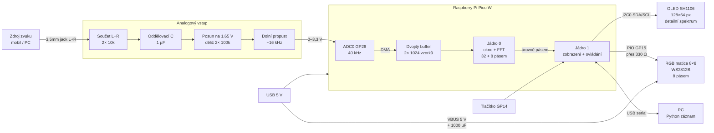

# Audio spectrum analyzer

DE2 team project – Raspberry Pi Pico W, MicroPython.

## Goal
Sample audio from audio input, split it into frequency bands
and show a live spectrum on a display and a MAX LED Matrix.

## Hardware
- Raspberry Pi Pico W

- Jack 3.5mm input

- display RGB LED matice 8 x 8 Neopixel WS2812B

## Block diagram

## Planned files
- `main.py` – main loop
- `config.py` – pins and settings
- `mic.py` – ADC sampling
- `spectrum.py` – FFT and frequency bands
- `display.py` – bars on the display
- `leds.py` – NeoPixel output

## Structure
TBD

## Functions
TBD

## Classes / API (draft)

### `AudioInput` – audio_input.py
- `AudioInput(pin=26, n=256)` – ADC input on GP26
- `read_block()` → list of n samples (0–65535)

### `Spectrum` – spectrum.py
- `bands(samples)` → 8 levels in dB (63 Hz, 125 Hz … 8 kHz)

### `Loudness` – loudness.py
- `measure(samples)` → (rms_dbfs, peak_dbfs, clip)

### `OledView` – display.py
- `show_spectrum(levels)` – Mode 1
- `show_loudness(rms, peak, clip)` – Mode 2

### `Matrix` – matrix.py
- `bars(heights)` – 8 columns, height 0–8
- `vu(level, clip)` – full-width VU meter, top row blinks on clip
- `clear()`

### Button – GP14
- short press = switch mode (Spectrum / Loudness)

## Component tests

| Component | Interface / pins | Test file | Status |
| --- | --- | --- | --- |
| OLED SH1106 128×64 – Mode 1 layout (spectrum) | I2C0, GP4/GP5 | `tests/test_oled.py` | works |
| OLED SH1106 128×64 – Mode 2 layout (loudness) | I2C0, GP4/GP5 | `tests/test_mode2.py` | works |
| LED matrix 8×8 MAX7219 | SPI0, GP17/GP18/GP19 | `tests/test_matrix.py` | not tested yet |
| Audio input (jack + analog front-end) | ADC0, GP26 | `tests/test_adc.py` | not tested yet |
| Button (mode select) | GPIO, GP14 | `tests/test_button.py` | not tested yet |

Tests for Modes 1 and 2 use generated test data, not real audio yet.

## Team
| Name | Part |
| --- | --- |
| Rauf Iusupov | ... |
| Marek Malina | ... |
| Jaroslav Kapaňa | ... |

## Conclusion
Thank you for attention

## Poznamky
Režim 1 Spektrum: zobrazuje rozložení zvuku do 8 frekvenčních pásem (63, 125, 250, 500 Hz, 1, 2, 4, 8 kHz).
Display: úroveň každého pásma v dB a jeho frekvence
Matice: 8 barevných sloupců (zelená → žlutá → červená) s držením špičky

Režim 2 Hlasitost: měří úroveň signálu v dBFS.
Display: RMS, Sample peak,  varování CLIP
Matice: celoplošný VU metr, při clippingu bliká horní řádek červeně

Režim 3 Ladička: určuje dominantní frekvenci.
Display: tón (např. A), frekvence v Hz, odchylka v centech, šipka doleva nebo doprava podle směru podlazení k nejbližšímu tónu. 
Matice: zelená = naladěno (±5 centů), červená = rozladěno

Ovládání: krátký stisk tlačítka přepne režim, dlouhý vynuluje maximum a držení špičky.

Sehnat soucastky

Raspberry Pi Pico W + rozšiřující deska (máme)
OLED displej SH1106 128×64, I2C (máme)
Nepájivé pole (máme)
Propojovací kabely (máme)
USB kabel (máme)
AUX kabel 3,5mm jack–jack (máme)
RGB LED matice 8×8 WS2812B
3,5mm jack (adaptér na svorkovnici)
Tlačítko
Rezistor 10k – 2×
Rezistor 100k – 2×
Rezistor 1k – 1×
Rezistor 330 Ω – 1×
Kondenzátor 1 µF – 1×
Kondenzátor 10 nF – 1×
Kondenzátor 1000 µF / 10 V – 1×
(volitelně) převodník úrovní 74AHCT125 - je možné že LED matice nebude plně reagovat a bude potřeba přidat tento převodník. Není však nutný 

Bude potreba zesilovac? - zatím ne, uvidíme při testování 
